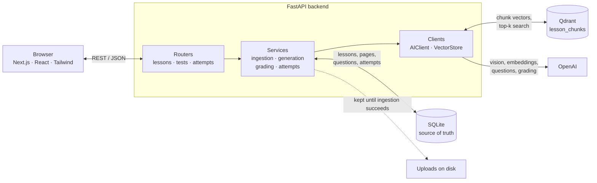
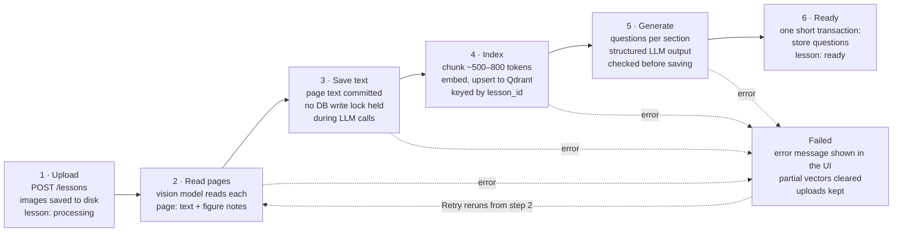
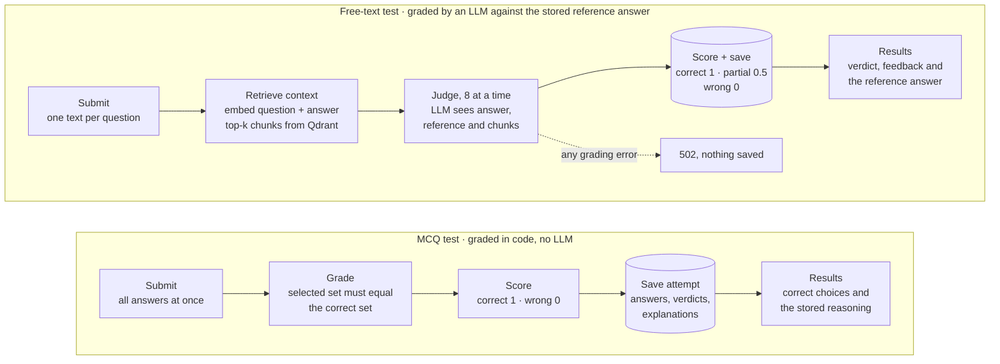
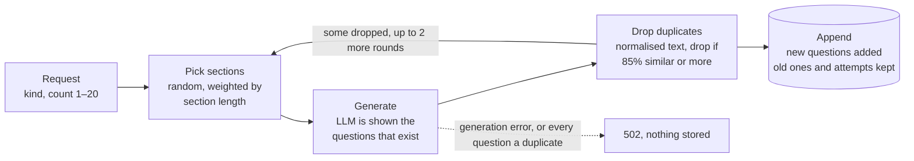

# Architecture

The browser only ever talks to the FastAPI backend. The backend owns every secret and every call to OpenAI and Qdrant, and reaches them through the `AIClient` and `VectorStore` protocols, which tests replace with fakes.

## System

`OPENAI_API_KEY`, `QDRANT_URL` and `QDRANT_API_KEY` live in `backend/.env`; the browser never receives them. Qdrant keeps every lesson in one collection, separated by a `lesson_id` payload field.

## Ingestion

An upload returns `202` at once. Steps 2–6 run as a FastAPI background task, and the page polls `GET /lessons/{id}` every 2 seconds until the status changes.

Lessons still `processing` when the server starts are failed the same way, so Retry works after a restart.

## Taking tests

MCQs are graded by a rule, free-text answers by an LLM judge.

## Generating more questions

`POST /lessons/{id}/questions` with `{"kind": "mcq" | "free_text", "count": 1-20}` adds questions of one kind to a `ready` lesson.

The duplicate check compares wording, not meaning, so the same fact asked in very different words can still get through.
